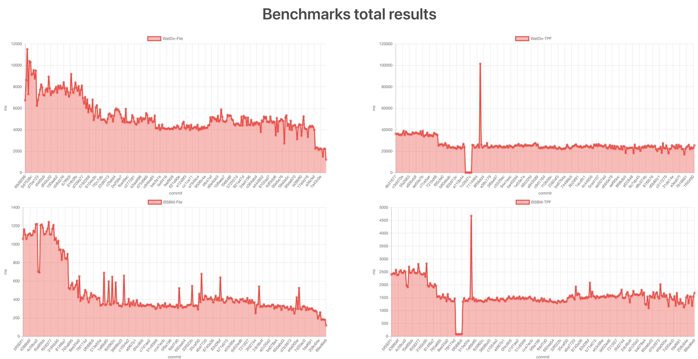

Besides flexibility, performance is of high importance of Comunica.
That is why we keep a close eye to it through continuous performance tracking and large scale benchmarks.

## Continuous performance tracking

To keep track of the evolution of Comunica's performance,
we enable continuous performance tracking into our continuous integration.
For various benchmarks, we can observe the evolution of execution times across our commit history.
This allows us to easily identify which changes have a positive or negative impact on performance.

For considering the performance for different aspects, we have included the following benchmarks:

- WatDiv (in-memory)
- WatDiv (TPF)
- Berlin SPARQL Benchmark (in-memory)
- Berlin SPARQL Benchmark (TPF)
- Custom web queries: manually crafted queries to test for specific edge cases over the live Web

This allows us to inspect performance as follows:

  

_Fluctuations in the graph are mainly caused by confounding variables in the GitHub Actions environment, such as running on different hardware and runner versions._

These results can be inspected in [more close detail](https://github.com/comunica/comunica-performance-results) together with execution times per query separately.

## Centralized performance

Despite Comunica focusing on query execution over decentralized Knowledge Graphs,
it's still possible to use Comunica to query over a single centralized Knowledge Graph,
such as an RDF file that it loads into memory.
To see how it compares to other engines in that setting,
we run three benchmarks at several dataset sizes:
the [WatDiv benchmark](https://dsg.uwaterloo.ca/watdiv/),
the [Berlin SPARQL benchmark (BSBM)](http://wbsg.informatik.uni-mannheim.de/bizer/berlinsparqlbenchmark/),
and the Interactive workload of the [LDBC Social Network Benchmark (SNB)](https://ldbcouncil.org/benchmarks/snb/).

The interactive table and chart below indicate how Comunica compares to other engines.

<centralized-performance>
</centralized-performance>

### Setup

The following engines were compared:

- [Comunica Memory](https://github.com/comunica/comunica/tree/master/engines/query-sparql-file#readme) (`@comunica/query-sparql-file` v5.5.0), using an [in-memory triple store](https://github.com/rubensworks/rdf-stores.js).
- [Comunica HDT](https://github.com/comunica/comunica-feature-hdt) (the same version, with `@comunica/actor-query-source-identify-hdt` v5.0.1), using an [HDT-based triple store](https://www.rdfhdt.org/). Not included in LDBC SNB.
- [Oxigraph](https://github.com/oxigraph/oxigraph) (v0.5.13): A Rust-based engine running natively, with its RocksDB-based store on disk, and with its in-memory store.
  This could also be run in the browser through WebAssembly, but was not part of these experiments.
  Preliminary tests indicate that through WebAssembly Oxigraph has a 10 to 15% slowdown of query execution and a 60% slowdown of ingestion.
- [Jena Fuseki](https://jena.apache.org/) (v6.2.0): A Java-based engine, with its TDB2 store on disk, and with its in-memory store.
- [Blazegraph](https://blazegraph.com/) (v2.1.5): A Java-based engine.
- [GraphDB](https://graphdb.ontotext.com/) (v10.8.14): A Java-based engine.
- [Virtuoso](https://vos.openlinksw.com/owiki/wiki/VOS/VOSSPARQL) (v7.2.17): An engine that translates SPARQL queries to SQL.
- [QLever](https://github.com/ad-freiburg/qlever/) ([24 October 2026](https://github.com/ad-freiburg/qlever/commit/afc421d)): A C++-based engine. Not included in BSBM due to QLever not yet supporting SPARQL/XML.

Each engine runs in its own Docker container, limited to one CPU core,
on a machine with 128 GB of memory and a 24-core 2.40 GHz CPU.
In-memory engines can use up to 100 GB of memory, and every query times out after 300 seconds.
For WatDiv and LDBC SNB, each query is executed three times after one warm-up round.
For BSBM, the times come from ten query mixes after five warm-up mixes.
These experiments were last executed in November 2026,
and are [fully reproducible](https://github.com/comunica/Experiments-Centralized).

[A write-up of earlier experiments with Comunica v4 can be found here.](https://www.rubensworks.net/blog/2025/04/22/cost-modularity-sparql/)
